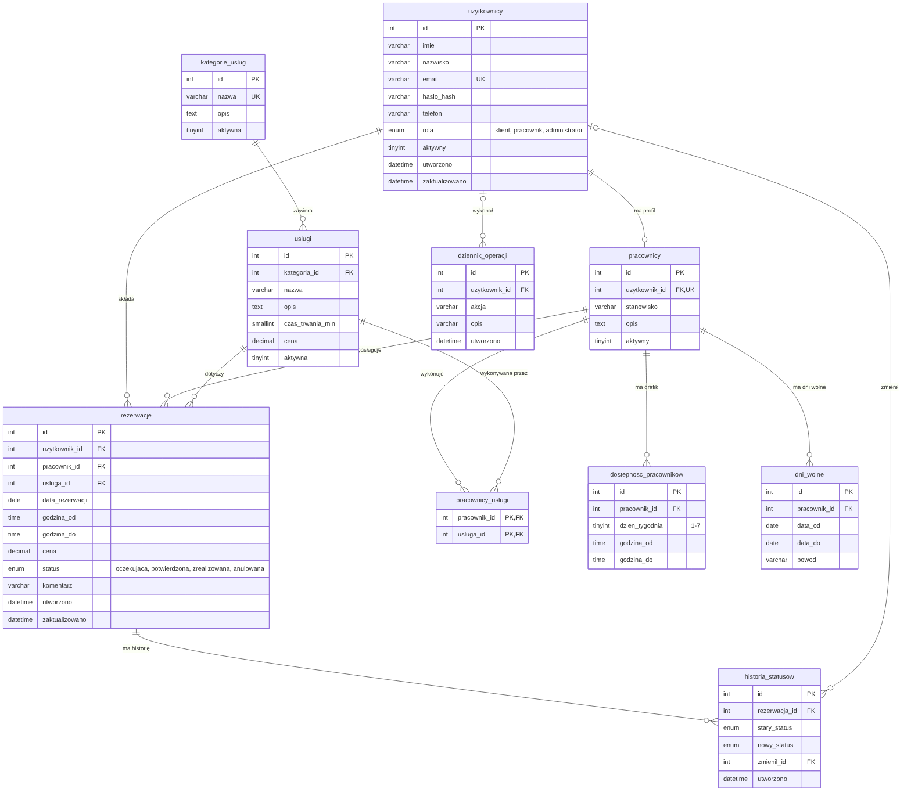

# SwissCar Import – system rezerwacji usług

# Link do strony

gitus-ugi.infinityfreeapp.com

# Autorzy

Imie i Nazwisko / GitHub
Jan Wodzyński / jwodz
Maciej Bieliński / Makro201
5KT

# Opis systemu

SwissCar Import to strona internetowa dla firmy, która sprowadza samochody ze Szwajcarii do Polski. Klient może zobaczyć ofertę i zarezerwować termin u wybranego pracownika, np. na konsultację, sprawdzenie historii auta po numerze VIN, przygotowanie dokumentów do cła, pomoc w rejestracji auta albo odbiór auta.

Sprowadzenie auta trwa kilka tygodni, dlatego w systemie rezerwuje się pojedyncze etapy. Każdy etap to spotkanie lub usługa, która trwa określony czas i jest wykonywana przez konkretnego pracownika w jego godzinach pracy.

W systemie są trzy rodzaje użytkowników:

- **Klient** – zakłada konto, przegląda ofertę, rezerwuje termin (usługa → pracownik → data → godzina → potwierdzenie), widzi swoje rezerwacje, może anulować przyszłą rezerwację i zmienić dane w profilu.
- **Pracownik** – widzi swoje wizyty na dziś, przyszłe wizyty i historię oraz zmienia ich status.
- **Administrator** – zarządza użytkownikami, pracownikami, kategoriami, usługami i godzinami pracy, widzi wszystkie rezerwacje i statystyki.

# Technologie

- PHP
- HTML5, CSS3, JavaScript
- MySQL
- Git i GitHub

# Struktura repozytorium

```
README.md
.gitignore
index.php                 – przekierowanie do folderu public
/config
    config.example.php    – wzór pliku z ustawieniami (bez haseł)
/database
    database.sql          – baza danych z danymi testowymi
/docs
    erd.png               – schemat bazy danych
/includes                 – wspólny kod PHP
    bootstrap.php         – start każdej strony: ustawienia, sesja, obsługa błędów
    db.php                – połączenie z bazą (PDO)
    session.php           – bezpieczne ustawienia sesji
    csrf.php              – ochrona formularzy tokenem CSRF
    auth.php              – logowanie, wylogowanie, kontrola ról
    validation.php        – sprawdzanie danych z formularzy
    helpers.php           – funkcje pomocnicze (e(), url(), komunikaty)
    panel.php             – dziennik operacji, parametry z adresu, stronicowanie list
    reservations.php      – statusy rezerwacji, historia zmian, filtry, formatowanie dat i cen
    /layout               – nagłówek, stopka, menu panelu admina, strona błędu, brak dostępu
/public                   – strony widoczne w przeglądarce
    index.php             – strona główna
    rejestracja.php
    logowanie.php
    wyloguj.php
    profil.php            – edycja danych i zmiana hasła
    /klient/index.php     – panel klienta
    /pracownik/index.php  – panel pracownika
    /admin                – panel administratora:
        index.php         – pulpit ze statystykami i wykresami
        rezerwacje.php    – lista rezerwacji z filtrami
        rezerwacja.php    – szczegóły, zmiana statusu, historia
        eksport.php       – eksport rezerwacji do CSV
        kategorie.php, kategoria.php   – lista i formularz kategorii
        uslugi.php, usluga.php         – lista i formularz usług
        pracownicy.php, pracownik.php  – lista i formularz pracowników (z usługami)
        grafik.php        – godziny pracy i dni wolne pracownika
        uzytkownicy.php   – lista kont, blokowanie
        dziennik.php      – dziennik operacji administratora
    /css
    /js
    /images
```

# Instrukcja uruchomienia

Potrzebny jest XAMPP (albo inny serwer z PHP i MySQL 8.0.16 lub nowszym).

1. Pobierz repozytorium do folderu `htdocs` w XAMPP.
2. W panelu XAMPP włącz **Apache** i **MySQL**.
3. Wejdź na `http://localhost/phpmyadmin`, otwórz zakładkę **Import** i wczytaj plik `database/database.sql`. Baza `swisscar_rezerwacje` utworzy się sama, razem z danymi testowymi. Po każdej zmianie pliku SQL (np. nowe tabele w etapie 3) zaimportuj go ponownie – skrypt usuwa starą bazę i tworzy ją od nowa.
4. Skopiuj plik `config/config.example.php`, nazwij kopię `config.php` i wpisz w niej dane do bazy (w XAMPP zwykle użytkownik `root` bez hasła).
5. Otwórz w przeglądarce: `http://localhost/NAZWA_KATALOGU/` (strona sama przeniesie do folderu `public`).

> Plik `config/config.php` nie trafia na GitHuba (jest w `.gitignore`), więc hasła do bazy nie są publiczne.

> Ustawienie `debug` w `config.php`: `true` pokazuje szczegóły błędów (tylko podczas pisania kodu), `false` pokazuje użytkownikowi tylko ogólny komunikat.

# Testowe dane logowania

Hasło do wszystkich kont: **`Test123!`**

| Rola | E-mail |
|---|---|
| Administrator | admin@swisscar.pl |
| Pracownik (doradca importowy) | marta.nowak@swisscar.pl |
| Pracownik (specjalista ds. dokumentów) | piotr.wisniewski@swisscar.pl |
| Pracownik (rzeczoznawca) | katarzyna.wojcik@swisscar.pl |
| Klient | jan.zielinski@example.com |
| Klient | ewa.lewandowska@example.com |
| Klient (konto nieaktywne) | robert.mazur@example.com |

Hasła w bazie są zaszyfrowane funkcją `password_hash()`, a nie zapisane zwykłym tekstem.

# Konta i logowanie

- **Rejestracja** – formularz z imieniem, nazwiskiem, e-mailem, telefonem, hasłem i powtórzeniem hasła. Nowe konto zawsze dostaje rolę klienta.
- **Logowanie** – e-mailem i hasłem. Po zalogowaniu każda rola trafia do swojego panelu:

| Rola | Panel |
|---|---|
| Klient | `public/klient/index.php` |
| Pracownik | `public/pracownik/index.php` |
| Administrator | `public/admin/index.php` |

- **Wylogowanie** – przyciskiem „Wyloguj” w menu.
- **Profil** – każdy zalogowany użytkownik może zmienić imię, nazwisko, e-mail i telefon oraz zmienić hasło (po podaniu obecnego).

### Zasady sprawdzania danych (po stronie serwera)

| Pole | Zasada |
|---|---|
| Imię, nazwisko | wymagane, od 2 znaków, tylko litery (także polskie), spacja i myślnik |
| E-mail | wymagany, poprawny format, nie może być zajęty przez inne konto |
| Telefon | wymagany, 9–15 cyfr, może zaczynać się od `+` (spacje i myślniki są usuwane) |
| Hasło | min. 8 znaków, co najmniej jedna litera i jedna cyfra |
| Powtórzone hasło | musi być takie samo jak hasło |

Formularz pokazuje błąd pod każdym źle wypełnionym polem i zachowuje wpisane dane (oprócz haseł).

# Bezpieczeństwo

| Zagrożenie | Jak się bronimy | Gdzie w kodzie |
|---|---|---|
| Wyciek haseł z bazy | hasła zapisane jako hash (`password_hash()`), sprawdzane przez `password_verify()` | `auth.php`, `rejestracja.php` |
| SQL injection | każde zapytanie z danymi od użytkownika to prepared statement (PDO) | wszystkie pliki z zapytaniami |
| Wejście do cudzego panelu przez wpisanie adresu | każda chroniona strona zaczyna się od `require_login()` lub `require_role()`; zła rola dostaje stronę „Brak dostępu” (kod 403) | `auth.php` |
| Rejestracja jako administrator | rola nie jest pobierana z formularza, zawsze `klient` | `rejestracja.php` |
| Zmiana cudzych danych w profilu | id użytkownika pochodzi z sesji, nie z formularza | `profil.php` |
| XSS (wstrzyknięcie kodu HTML/JS) | każdy tekst wypisywany na stronie przechodzi przez funkcję `e()` (`htmlspecialchars`) | `helpers.php`, widoki |
| CSRF (wysłanie formularza z obcej strony) | ukryty token w każdym formularzu POST, sprawdzany na serwerze | `csrf.php` |
| Przejęcie sesji | nowy identyfikator sesji po zalogowaniu i zmianie hasła; ciasteczko `HttpOnly` i `SameSite` | `auth.php`, `session.php` |
| Pozostawiony zalogowany komputer | automatyczne wylogowanie po 30 minutach bez aktywności | `auth.php` |
| Zablokowane konto nadal zalogowane | dane użytkownika są sprawdzane w bazie przy każdym wejściu na stronę | `auth.php` |
| Sprawdzanie, czy e-mail ma konto | ten sam komunikat przy złym e-mailu i złym haśle | `auth.php` |
| Ujawnienie szczegółów błędu | użytkownik widzi ogólny komunikat, szczegóły trafiają do logu serwera | `bootstrap.php` |
| Operacje administratora wywołane przez innego użytkownika | każda strona panelu (także zapis formularza i eksport) zaczyna się od `require_role('administrator')` | `public/admin/*.php` |
| Usunięcie lub zmiana nie swojego wpisu przez podmianę id | wpisy grafiku i dni wolnych są usuwane tylko z warunkiem `pracownik_id = ?` | `grafik.php` |
| Utrata historii przez usunięcie danych | usługi z rezerwacjami i kategorie z usługami nie dają się usunąć – można je tylko dezaktywować | `kategorie.php`, `uslugi.php` |
| Formuły w pliku CSV (CSV injection) | wartości zaczynające się od `= + - @` dostają apostrof, więc Excel nie uruchomi ich jako formuły | `eksport.php` |
| Przypadkowe kliknięcie „Usuń” | okienko z pytaniem przed usunięciem, blokadą i anulowaniem | `formularze.js` |
| Hasło do bazy na GitHubie | `config.php` jest w `.gitignore` | `.gitignore` |

# Panel administratora

Panel jest dostępny tylko dla roli administratora (`public/admin/`). Menu panelu: Pulpit, Rezerwacje, Kategorie, Usługi, Pracownicy, Użytkownicy, Dziennik operacji.

| Moduł | Co można zrobić |
|---|---|
| **Pulpit** | liczba rezerwacji na dziś i wszystkich, przychód w bieżącym miesiącu, liczba klientów, pracowników i usług; lista wizyt na dziś; wykresy: wizyty w najbliższych 14 dniach, rezerwacje według statusu, najpopularniejsze usługi; ostatnie operacje |
| **Rezerwacje** | lista z filtrowaniem po dacie (od–do), statusie, pracowniku i kliencie; stronicowanie; szczegóły rezerwacji; zmiana statusu i anulowanie; historia zmian statusu; eksport do CSV |
| **Kategorie** | dodawanie, edycja, aktywowanie/dezaktywowanie, usuwanie (tylko pustych), wyszukiwanie |
| **Usługi** | dodawanie, edycja (kategoria, cena, czas trwania, opis), aktywowanie/dezaktywowanie, usuwanie (tylko bez rezerwacji), filtrowanie po kategorii i statusie, wyszukiwanie |
| **Pracownicy** | dodawanie pracownika razem z kontem, edycja danych i stanowiska, przypisywanie wielu usług, aktywowanie/dezaktywowanie, wyszukiwanie |
| **Grafik** | tygodniowe godziny pracy (także kilka przedziałów w jednym dniu, np. z przerwą) oraz dni wolne i urlopy |
| **Użytkownicy** | lista kont z wyszukiwaniem i filtrem roli, blokowanie i odblokowywanie kont |
| **Dziennik operacji** | kto, co i kiedy zmienił w panelu, z wyszukiwaniem |

### Zasady w panelu

| Sytuacja | Co robi system |
|---|---|
| Usunięcie kategorii, do której należą usługi | odmowa z wyjaśnieniem – trzeba przenieść usługi albo dezaktywować kategorię |
| Usunięcie usługi, która ma rezerwacje | odmowa – usługę można dezaktywować (zniknie z oferty, historia zostanie) |
| Zmiana ceny usługi | stare rezerwacje zachowują swoją cenę |
| Dezaktywacja pracownika z umówionymi wizytami | zmiana się udaje, ale pojawia się ostrzeżenie z liczbą wizyt |
| Godziny pracy nachodzące na inne godziny tego samego dnia | odmowa; przedziały stykające się (np. 9:00–12:00 i 12:00–15:00) są dozwolone |
| Dni wolne w przeszłości lub nachodzące na inne dni wolne | odmowa |
| Dni wolne w okresie, w którym są umówione wizyty | zapis się udaje, ale pojawia się ostrzeżenie z liczbą wizyt |
| Zablokowanie własnego konta | odmowa – administrator straciłby dostęp do panelu |
| Oznaczenie przyszłej wizyty jako zrealizowanej | odmowa |
| Przywrócenie anulowanej rezerwacji | odmowa – termin mógł zająć ktoś inny |

Dozwolone zmiany statusu rezerwacji:

| Obecny status | Można zmienić na |
|---|---|
| Oczekująca | Potwierdzona, Zrealizowana, Anulowana |
| Potwierdzona | Oczekująca, Zrealizowana, Anulowana |
| Zrealizowana | Potwierdzona (poprawka pomyłki) |
| Anulowana | – |

### Walidacja formularzy panelu

| Pole | Zasada |
|---|---|
| Nazwa kategorii | od 2 do 100 znaków, unikalna |
| Nazwa usługi | od 2 do 150 znaków, unikalna w obrębie kategorii |
| Czas trwania usługi | liczba całkowita od 5 do 480 minut, co 5 minut |
| Cena | od 0 do 99 999,99 zł, najwyżej 2 miejsca po przecinku (można wpisać przecinek) |
| Kategoria usługi, usługi pracownika | tylko wartości istniejące w bazie (podmienione id są pomijane) |
| Stanowisko | od 2 do 100 znaków |
| Godziny pracy | format GG:MM, koniec później niż początek |
| Dni wolne | poprawne daty, koniec nie wcześniej niż początek, nie w przeszłości |
| Filtry w adresie URL | błędne wartości (np. `status=xyz`, `strona=abc`, data `2026-02-30`) są ignorowane |

# Baza danych

# Diagram ERD



# Tabele

| Tabela | Co przechowuje |
|---|---|
| `uzytkownicy` | konta wszystkich użytkowników (klient, pracownik, administrator) |
| `kategorie_uslug` | kategorie usług |
| `uslugi` | usługi z ceną i czasem trwania |
| `pracownicy` | dodatkowe dane pracownika, połączone z jego kontem |
| `pracownicy_uslugi` | które usługi wykonuje który pracownik |
| `dostepnosc_pracownikow` | godziny pracy pracowników |
| `rezerwacje` | rezerwacje klientów i ich status |
| `dni_wolne` | urlopy i dni wolne pracowników (od–do, powód) |
| `historia_statusow` | każda zmiana statusu rezerwacji: stary i nowy status, kto i kiedy |
| `dziennik_operacji` | operacje wykonane w panelu administratora |

# Relacje

- **1:N** (jeden do wielu) – kategoria → usługi, użytkownik → rezerwacje, pracownik → rezerwacje, usługa → rezerwacje, pracownik → godziny pracy, pracownik → dni wolne, rezerwacja → historia statusów, użytkownik → wpisy w dzienniku
- **1:1** (jeden do jednego) – konto użytkownika → profil pracownika
- **N:M** (wiele do wielu) – pracownicy ↔ usługi, przez tabelę `pracownicy_uslugi`

# Najważniejsze decyzje projektowe

- **Ceny jako `DECIMAL(8,2)`** – typ `FLOAT` może źle zaokrąglać kwoty, a przy pieniądzach nie może być błędów.
- **Hasło w polu `VARCHAR(255)`** – zaszyfrowane hasło ma teraz ok. 60 znaków, ale w przyszłości może być dłuższe.
- **Cena zapisana w rezerwacji** – gdy administrator zmieni cenę usługi, stare rezerwacje zachowają cenę z dnia rezerwacji.
- **Godzina końca zapisana w rezerwacji** – gdy administrator zmieni czas trwania usługi, stare rezerwacje nie zmienią długości. Dzięki temu łatwo też sprawdzić, czy nowy termin nie nakłada się na inny.
- **Dane nie są usuwane** – usługi, kategorie, pracowników i użytkowników można wyłączyć, a rezerwacje się anuluje. Dzięki temu nie tracimy historii rezerwacji.
- **Usuwanie powiązanych danych** – nie da się usunąć czegoś, do czego są przypisane rezerwacje (`RESTRICT`). Po usunięciu pracownika jego godziny pracy i przypisane usługi usuwają się same (`CASCADE`).
- **Zabezpieczenia w bazie**:
  - `UNIQUE` – nie mogą się powtórzyć: e-mail, nazwa kategorii, nazwa usługi w kategorii, profil pracownika dla tego samego konta, te same godziny pracy,
  - `CHECK` – czas usługi większy od 0 (max 480 min), cena nie mniejsza niż 0, dzień tygodnia od 1 do 7, koniec później niż początek,
  - `ENUM` – można wpisać tylko ustalone role i statusy rezerwacji.
- **Dzień tygodnia 1–7** – 1 to poniedziałek, 7 to niedziela.
- **Indeksy** (przyspieszają wyszukiwanie):
  - `rezerwacje (pracownik_id, data_rezerwacji, godzina_od)` – szukanie zajętych godzin pracownika w danym dniu,
  - `rezerwacje (data_rezerwacji, status)` – filtrowanie rezerwacji w panelu administratora,
  - `uslugi (kategoria_id, aktywna)` – pokazywanie aktywnych usług z wybranej kategorii,
  - `dni_wolne (pracownik_id, data_od, data_do)` – sprawdzanie, czy pracownik ma wolne w danym dniu,
  - `historia_statusow (rezerwacja_id, utworzono)` – historia jednej rezerwacji,
  - `dziennik_operacji (utworzono)` – najnowsze wpisy dziennika.
- **Historia i dziennik przy usuwaniu kont** – `ON DELETE SET NULL`: wpis zostaje, tylko bez autora.
- **Zmiana statusu i wpis w historii w jednej transakcji** – nie może się zdarzyć, że status się zmieni, a historia nie.

# Dane testowe

W bazie są: 1 administrator, 3 pracowników z różnymi godzinami pracy (jeden ma przerwę), 5 klientów (jedno konto jest wyłączone), 4 kategorie, 11 usług (jedna wyłączona), 28 rezerwacji z września–grudnia we wszystkich statusach (część z historią zmian statusu) oraz dni wolne dwóch pracowników. Dwie rezerwacje są jedna po drugiej (jedna kończy się, a druga zaczyna o 11:00), żeby pokazać, że takie terminy są dozwolone.

# Funkcje dodatkowe

Zrobione:

- **Tokeny CSRF** we wszystkich formularzach.
- **Zmiana hasła** tylko po podaniu obecnego hasła.
- **Automatyczne wylogowanie** po 30 minutach bez aktywności.
- **Natychmiastowa blokada konta** – wyłączony użytkownik jest wylogowywany przy następnym wejściu na stronę.
- **Aktualizacja hashy haseł** – przy logowaniu stary hash jest zamieniany na nowszy, jeśli PHP zmieni algorytm.
- **Wykresy i statystyki** na pulpicie administratora – zwykły HTML i CSS, bez zewnętrznych bibliotek.
- **Historia zmian statusów** każdej rezerwacji (kto i kiedy zmienił).
- **Dziennik operacji administratora** z wyszukiwaniem.
- **Eksport rezerwacji do CSV** z tymi samymi filtrami co lista, z ochroną przed CSV injection.
- **Dni wolne i urlopy pracowników** z ostrzeżeniem o kolidujących wizytach.
- **Kilka przedziałów godzin pracy w jednym dniu** (przerwy).
- **Zaawansowane filtrowanie i stronicowanie** list w panelu.

# Postęp prac

| Etap | Termin | Zakres | Status |
|---|---|---|---|
| 1 | 25.09.2026 | Projekt, GitHub i baza danych | ✅ ukończony |
| 2 | 16.10.2026 | Użytkownicy i logowanie | ✅ ukończony |
| 3 | 06.11.2026 | Panel administracyjny | ✅ ukończony |
| 4 | 20.11.2026 | Klient i rezerwacje | ⏳ |
| 5 | 27.11.2026 | Kompletny projekt i prezentacja | ⏳ |
